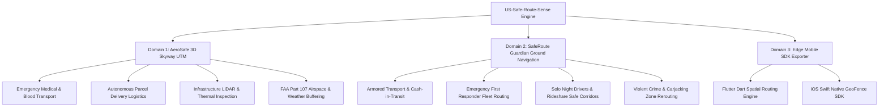

# US-Safe-Route-Sense: System Use Cases & Technical Architecture

## 1. Executive Summary & Vision

**US-Safe-Route-Sense** (`AeroSafe 3D Skyway` & `SafeRoute Guardian`) is a dual-domain autonomous spatial navigation platform designed to solve the fatal blind spots of traditional consumer navigation (e.g., Google Maps, Apple Maps, Waze).

Standard navigation software uses a single objective function: **minimize travel time**. In high-stakes environments, this leads to two critical vulnerabilities:
1. **Physical Security Failure (Ground)**: Routing delivery drivers, VIP convoys, solo night commuters, or emergency medical fleets straight through violent crime hotspots, carjacking zones, and unlit slums to save seconds.
2. **Airspace & Regulatory Failure (Drone / UTM)**: Direct straight-line UAV flight paths violate FAA Part 107 rules, penetrate temporary flight restrictions (TFR), fly over unsheltered human gatherings (Part 107.39), and intercept destructive atmospheric wind-shear funnels and noise-sensitive hospital/residential corridors.

**US-Safe-Route-Sense** provides:
- **AeroSafe 3D Skyway Engine**: Unmanned Traffic Management (UTM) routing with continuous 3D altitude profiling, dynamic wind-shear & No-Fly Zone (NFZ) buffering, battery State-of-Charge (SoC) projection, and acoustic compliance monitoring.
- **SafeRoute Guardian Engine**: Open Source Routing Machine (OSRM) physical road snapping with geofenced crime avoidance, calculating a transparent **Safe-to-Direct Rate** comparing detour distance against crime evasion metrics.
- **Edge Mobile SDK**: Auto-generated Flutter (Dart) and iOS (Swift) spatial navigation engines for in-vehicle and on-drone embedded deployment without continuous cloud roundtrips.

---

## 2. Precise Use Cases



### Use Case 1: AeroSafe 3D Skyway (FAA Part 107 UTM)

| Attribute | Specification |
| :--- | :--- |
| **Target Personas** | UAV Fleet Dispatchers, Hospital Emergency Logistics Coordinators, Autonomous Delivery Operators (Zipline/Wing style), Utility Surveyors. |
| **Operational Constraints** | Maximum legal altitude: 120m AGL (FAA Part 107.51); strictly zero flight over unsheltered public assemblies (Part 107.39); noise limits &lt; 65 dBA over hospitals/residential areas. |
| **Atmospheric Hazards** | Microburst wind-shear cells (&gt; 35 knots), squall lines, heavy precipitation radar cores. |
| **Core Deliverables** | Continuous 3D climb/cruise/descent trajectory; automated 3D cylindrical buffer detours around storms and NFZs; acoustic footprint scoring; battery consumption model. |
| **Mission Presets** | 1) *Emergency Medical & Blood Transport* (High-speed, 115m AGL, priority airspace); 2) *Regional Autonomous Parcel* (Standard freight, 95m AGL); 3) *Infrastructure LiDAR Scan* (Low-altitude 80m AGL inspection). |

### Use Case 2: SafeRoute Guardian Ground Navigation (OSRM Snapped)

| Attribute | Specification |
| :--- | :--- |
| **Target Personas** | Armored Transport Couriers, High-Value Cargo Logistics, EMS Ambulance Fleets, Solo Night Drivers, Rideshare Drivers. |
| **Threat Matrix** | Violent assault corridors, carjacking choke-points, gang-disputed territories, unlit industrial corridors, civil unrest perimeters. |
| **Algorithmic Model** | OSRM physical highway and arterial snapping with spatial waypoint detours outside circular danger perimeters. |
| **Safe-to-Direct Rate** | Quantifies trade-offs in real time (e.g. *+7.8% travel distance / +2 mins travel time in exchange for evading 100% violent crime exposure / 146 incidents/mo*). |
| **Guidance HUD** | Real-time turn-by-turn maneuvers with Web Speech API voice advisories and risk warning alerts. |

### Use Case 3: On-Device Edge & Mobile Deployment (Flutter / Swift)

| Attribute | Specification |
| :--- | :--- |
| **Target Personas** | Mobile App Developers, In-Vehicle Dash Unit Engineers, Drone Ground Control Station (GCS) Integrators. |
| **Problem Solved** | High-security vehicles and autonomous drones often encounter degraded cellular or GPS-denied environments where cloud navigation APIs timeout. |
| **Export Formats** | 1) **Flutter (Dart)**: Complete `SafeRouteEngine` service with A* heuristic cost penalties; 2) **iOS (Swift)**: `SafeRouteManager` utilizing Apple CoreLocation and MapKit overlays; 3) **Pubspec / Podspec**: Dependency specifications ready for copy-paste integration. |

---

## 3. Upgraded Code Structure

The project has been refactored from an unstructured prototype into a clean, domain-driven modular architecture:

```
src/
├── types/                           # Centralized domain models
│   ├── navigation.ts                # NavMode, CameraMode, PickingMode, GeoPoint
│   ├── drone.ts                     # Re-exported UAV hazards, missions, corridor models
│   └── ground.ts                    # Re-exported crime zones, city presets, route types
│
├── hooks/                           # Encapsulated state & business logic
│   ├── useNavigationState.ts        # City/corridor switcher, origin/dest, dynamic hazards
│   ├── useGroundRouting.ts          # Async OSRM route fetcher, caching, state
│   ├── useDroneRouting.ts           # 3D flight paths, altitude profiles, energy calculation
│   ├── useRouteSimulation.ts        # 50ms animation ticker, progress interpolation, step sync
│   └── useVoiceGuidance.ts          # Web Speech Synthesis with rate/pitch control & deduplication
│
├── components/
│   ├── map/                         # MapLibre GL 3D Quarter-View
│   │   ├── RealMapQuarterView.tsx   # Core map controller (reduced from 611 to 270 lines)
│   │   ├── MapMarkers.ts            # SkyPad A/B, Quadcopter 3D, and Vehicle markers
│   │   └── MapLayers.ts             # GeoJSON routes, danger zones, and highlight layers
│   │
│   ├── hud/                         # Tesla Glass Overlay Subcomponents
│   │   ├── TeslaGlassOverlay.tsx    # Clean layout composition (reduced from 611 to 150 lines)
│   │   ├── TopControlCard.tsx       # Mode switcher, corridor dropdown, drone mission cards
│   │   ├── WaypointRouteCard.tsx    # Waypoints, route comparison cards, Safe-to-Direct badge
│   │   ├── TurnByTurnBanner.tsx     # Maneuver icon, step instruction, audio toggle
│   │   ├── ActionToolstrip.tsx      # Camera modes (3D/Follow/2D), Use Cases modal, analytics
│   │   ├── InteractivePickingBar.tsx# Visual crosshair prompt when dropping map pins
│   │   ├── BottomPlaybackBar.tsx    # Play/Pause, timeline scrubber, altitude drawer toggle
│   │   └── DroneAltitudeProfileHUD.tsx # SVG 3D altitude profile with terrain clearance
│   │
│   ├── intel/                       # System Briefing & Use Cases Dialog
│   │   └── UseCaseModal.tsx         # Interactive specifications, personas, and feature matrix
│   │
│   ├── analytics/                   # Telemetry & Risk Drawer
│   │   └── DangerAnalyticsPanel.tsx # Crime exposure vs drone flight stats
│   │
│   ├── export/                      # Code Export Dialog
│   │   └── MobilePlatformExportModal.tsx # Flutter (Dart) & Swift code suite
│   │
│   └── ui/                          # shadcn-ui atomic components
│
├── lib/                             # Core algorithms and data
│   ├── danger-zones.ts              # City presets & crime database
│   ├── drone-hazards.ts             # Drone corridor presets & airspace hazards
│   ├── safe-routing-engine.ts       # OSRM highway snapping & Safe-to-Direct math
│   ├── drone-routing-engine.ts      # 3D aero-path generator & flight telemetry
│   ├── mobile-code-templates.ts     # Dart & Swift production code templates
│   └── utils.ts                     # UI utility helpers
│
└── pages/
    └── Index.tsx                    # Clean top-level orchestrator (reduced from 374 to 145 lines)
```

---

## 4. Key Mathematical & Algorithmic Foundations

### 4.1 Safe-to-Direct Rate
For ground navigation, safety performance is evaluated against the naive direct route:

$$\text{Safety Gain (\%)} = \frac{\text{Safety Score}_{\text{safe}} - \text{Safety Score}_{\text{direct}}}{\text{Safety Score}_{\text{direct}}} \times 100$$

$$\text{Detour Cost (\%)} = \frac{\text{Distance}_{\text{safe}} - \text{Distance}_{\text{direct}}}{\text{Distance}_{\text{direct}}} \times 100$$

### 4.2 3D Airspace Corridor Buffer Calculation
For UAV skyways, every point $\mathbf{P}(t) = (x(t), y(t), z(t))$ along the flight path satisfies:

$$z(t) \le 120\text{m AGL} \quad \text{(FAA Part 107 ceiling)}$$

$$d(\mathbf{P}(t), \mathbf{C}_{\text{hazard}}) > R_{\text{hazard}} + \text{Margin}_{\text{safety}}$$

When a weather disturbance or NFZ is placed, the AeroSafe routing engine injects quadratic Bézier tangent control points around the hazard perimeter with automatic vertical clearance elevation.
